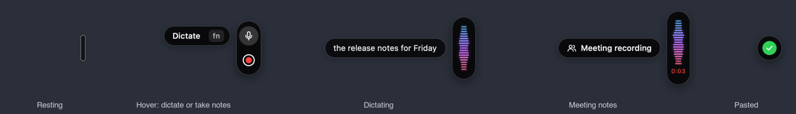
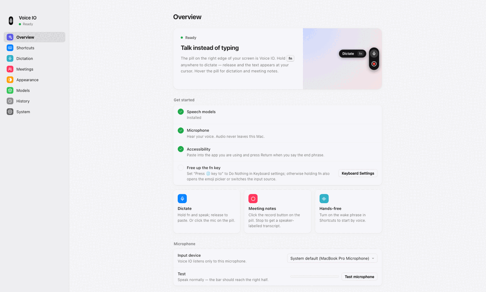

# Voice IO

**Talk instead of typing, on your own computer.** Voice IO is a free, open-source dictation app for macOS, Windows and Linux (GNOME). Hold a key, speak, let go: the text appears wherever your cursor is. It can also take meeting notes with the speakers labelled.

Speech recognition runs on your machine with [sherpa-onnx](https://github.com/k2-fsa/sherpa-onnx) and NVIDIA's [Parakeet](https://huggingface.co/nvidia/parakeet-tdt-0.6b-v2) model. Your voice never leaves the computer. There is no account, subscription or usage limit. If you like the hold-a-key-and-talk workflow of apps such as [Wispr Flow](https://wisprflow.ai) but want it free, open source and self-hosted, this is that.



## Features

- **Dictate into any app.** On a Mac, hold **fn**, speak and release. On every platform you can also use a shortcut. The text is pasted at the cursor and your clipboard is put back afterwards.
- **Live preview.** A small pill on the edge of the screen shows a waveform of your voice and your last few words as you speak.
- **Hands-free.** Say "hey voice", dictate, then say "voice send". Voice IO pastes the text and presses Return, which is handy for chat and AI prompts.
- **Meeting notes.** Record a conversation and get a Markdown transcript with timestamps and labelled speakers. A language model of your choice can add a summary.
- **Collaborative drafts.** Several people can talk around one microphone. Voice IO pastes an editable draft labelled by speaker.
- **Cleanup.**
  - Your own vocabulary.
  - Removal of filler words.
  - Spoken emoji, for example "thumbs up emoji".
  - Snippets that turn a keyword into fixed text.
- **Optional AI polish.** Point Voice IO at [Ollama](https://ollama.com) or any OpenAI-compatible server to fix grammar in short dictations. It is off until you set an endpoint.
- **Nothing is lost.** If text can't be pasted, Voice IO copies it and keeps it for 24 hours.
- **Private.** Audio and transcripts stay on your computer. Models are downloaded once from their publishers and checked against pinned SHA-256 hashes.

Voice IO understands English only.

## Requirements

| | macOS | Windows | Linux |
| --- | --- | --- | --- |
| System | macOS 13 Ventura or later. Built and used on Apple silicon; Intel Macs should work but are untested. | Windows 10 or 11, x64. Tested on Windows Server 2022. | GNOME 45 or later on Wayland. X11 sessions are not supported. |
| To build | Go 1.24 or later, plus the Xcode Command Line Tools | Go 1.24 or later, plus mingw-w64 (gcc and windres) and zip. On Windows, MSYS2 provides them. | Go 1.24 or later, gcc, pkg-config and the GTK 3 headers |
| To run | Nothing else | Nothing else | wl-clipboard, ydotool and XWayland |
| Disk | About 830 MB of speech models, plus 47 MB for meeting notes | Same | Same |

While it runs, Voice IO uses about 2 GB of memory, measured on macOS. The models stay loaded so that dictation starts instantly.

macOS is the main platform. Windows and Linux support is newer and has had less real-world use, so bug reports are welcome.

## Install on macOS

1. Install the build tools.

   ```sh
   xcode-select --install    # Xcode Command Line Tools; skip if already installed
   brew install go           # or install Go 1.24+ from https://go.dev/dl
   ```

2. Build and install Voice IO.

   ```sh
   git clone https://github.com/lyc-aon/voice-io.git
   cd voice-io
   scripts/install           # builds ~/Applications/Voice IO.app and links ~/.local/bin/voice-io
   ```

   If `~/.local/bin` is not on your `PATH`, add it or run `~/.local/bin/voice-io` directly.

3. Download the speech models. You only need to do this once.

   ```sh
   voice-io models install            # about 830 MB
   voice-io models install --meeting  # also the speaker models for meeting notes (47 MB more)
   ```

4. Start it.

   ```sh
   voice-io start            # or open Voice IO from ~/Applications
   ```

A small pill appears on the right edge of the screen and an icon appears in the menu bar. Voice IO has no Dock icon.

### Permissions on macOS

macOS asks for two permissions. Allow both, either when asked or in System Settings › Privacy & Security.

- **Microphone**, so that Voice IO can hear you.
- **Accessibility**, so that Voice IO can paste into the app you are using, press Return for the end phrase and notice the fn key. Until you allow it, Voice IO copies the text instead of pasting it and shows an **Allow** button on the pill.

To dictate by holding **fn**, open System Settings › Keyboard and set **Press 🌐 key to** to **Do Nothing**. Otherwise holding fn also opens the emoji picker or switches the input source.

`scripts/install` signs the app with your Developer ID if your keychain has one. Otherwise it signs the app ad hoc, which works fine on your own Mac. Because the app was built locally, Gatekeeper does not block it.

## Install on Windows

1. Build the Windows package. On Windows, install [Go](https://go.dev/dl) and [MSYS2](https://www.msys2.org), then open the **MSYS2 MINGW64** shell:

   ```sh
   pacman -S --needed git zip mingw-w64-x86_64-gcc
   export PATH="$PATH:/c/Program Files/Go/bin"
   git clone https://github.com/lyc-aon/voice-io.git
   cd voice-io
   CC=gcc WINDRES=windres scripts/build-windows
   ```

   You can also cross-compile on a Mac (`brew install mingw-w64`) or on Linux (`sudo apt install gcc-mingw-w64-x86-64 binutils-mingw-w64-x86-64 zip`) by running `scripts/build-windows`. Either way, the result is `dist/voice-io-2.0.0-windows-x64.zip`.

2. Unzip it to a folder you keep, for example `%LOCALAPPDATA%\Programs\Voice IO`. The folder holds two programs:
   - **Voice IO.exe** is the app.
   - **voice-io.exe** is the same program for the command line.

3. Download the speech models. Open a terminal in that folder and run:

   ```powershell
   .\voice-io.exe models install            # about 830 MB
   .\voice-io.exe models install --meeting  # also the speaker models for meeting notes
   ```

4. Double-click **Voice IO.exe**. The pill appears on the right edge of the screen, and an icon appears in the notification area. Windows may first put the icon in the overflow behind **^**; you can drag it onto the taskbar.

5. Optionally, turn on Settings › System › **Open at login**. To add Voice IO to the Start menu, right-click **Voice IO.exe** and choose **Pin to Start**.

Windows doesn't ask for permission. In Settings › Privacy & security › Microphone, make sure **Microphone access** and **Let desktop apps access your microphone** are both on. Windows Server turns microphone access off by default.

Windows has no fn key for apps. To dictate, press **Ctrl+Alt+Space** once to start and again to finish, or hold it and let go when you're done.

## Install on Linux (GNOME on Wayland)

1. Install the dependencies.

   ```sh
   # Ubuntu or Debian
   sudo apt install git gcc pkg-config libgtk-3-dev wl-clipboard ydotool
   # Fedora
   sudo dnf install git gcc pkgconf-pkg-config gtk3-devel wl-clipboard ydotool
   # Arch
   sudo pacman -S git go gcc pkgconf gtk3 wl-clipboard ydotool
   ```

   You also need Go 1.24 or later. The `golang-go` package in Ubuntu 24.04 is too old. Get Go from [go.dev/dl](https://go.dev/dl) or run `sudo snap install go --classic`.

2. Build and install Voice IO.

   ```sh
   git clone https://github.com/lyc-aon/voice-io.git
   cd voice-io
   scripts/install --desktop
   ```

   This installs the following. None of it is enabled automatically.
   - The program, in `~/.local/lib/voice-io`.
   - The `voice-io` command, in `~/.local/bin`.
   - An app launcher and icon.
   - The GNOME focus extension.
   - Two systemd user units, `voice-io` and `ydotoold`.

3. Allow ydotool to send the paste shortcut. ydotool writes to `/dev/uinput`, which needs a udev rule and membership of the `input` group:

   ```sh
   sudo install -m 644 packaging/linux/99-voiceio-uinput.rules /etc/udev/rules.d/
   sudo usermod -aG input "$USER"
   ```

   Restart the computer afterwards. Be aware that members of the `input` group can read every input device, including the keyboard, so consider this before you grant it.

   ydotool 1.x also needs its daemon. Fedora, Arch, and Debian 13 and later ship 1.x. Start the daemon with:

   ```sh
   systemctl --user enable --now ydotoold
   ```

   ydotool 0.1.x works without the daemon; Ubuntu 24.04 and Debian 12 ship it. To check which version you have, run `ydotool help`: only 1.x mentions `YDOTOOL_SOCKET`.

4. Download the models and start Voice IO.

   ```sh
   voice-io models install            # add --meeting for meeting notes
   voice-io start
   ```

5. Connect Voice IO to GNOME.
   - **Shortcuts.** GNOME owns global shortcuts. Click **Apply GNOME shortcuts** in Settings › Shortcuts, or run `voice-io shortcuts apply`. GNOME already uses Ctrl+Alt+T to open a terminal, which is also Voice IO's default on/off shortcut. Change one of them first if you use both.
   - **Focus bridge (recommended).** Run `gnome-extensions enable gnome_focus@voice-io`. If GNOME has not found the extension yet, log out and back in first. The bridge lets Voice IO check that the window you started in is still focused before it pastes, and it allows the end phrase to press Return. Without it, Voice IO still pastes but never presses Return.
   - **Start at login.** Use Settings › System › Startup, or run `systemctl --user enable --now voice-io`.

Apps can't see the fn key on Linux. To dictate, press the shortcut once to start and again to finish, or click the microphone on the pill.

## Using Voice IO

| To | Do this |
| --- | --- |
| Dictate | **macOS:** hold **fn**, speak and release.<br>**Shortcut:** press **⌃⌥Space** (Ctrl+Alt+Space on Windows and Linux) to start and again to finish. On macOS and Windows you can also hold it and let go when you're done.<br>**Mouse:** hover over the pill and click the microphone. |
| Dictate hands-free | Say **"hey voice"**, speak, then say **"voice send"** to paste and press Return. |
| Take meeting notes | Hover over the pill and click the red record button. Click the pill to stop. |
| Cancel | Press **⌃⌥X** (Ctrl+Alt+X), or hover over the recording pill and click ×. |
| Pause listening | Press **⌃⌥T** (Ctrl+Alt+T), or use the menu. |
| Move the pill | Drag it up or down the edge of the screen. |
| Open Settings | Use the menu-bar icon (macOS) or notification-area icon (Windows), right-click the pill, or run `voice-io settings`. |
| Get back text that didn't paste | Use Settings › History, or run `voice-io recover` to copy the latest. |

While you speak, the pill shows a waveform of your voice and your last few words. Voice IO pastes the text once, when you finish, into whatever has focus at that moment. You can change shortcuts, phrases and the default recording mode in Settings › Shortcuts.

By default Voice IO listens for the wake phrase, so the microphone stays open while it is idle and macOS shows its orange microphone indicator. A small keyword model processes that audio in memory. Nothing is recorded or saved until a session starts. If you'd rather not keep the microphone open, turn off Settings › Shortcuts › **Listen for the wake phrase**.

### Meeting notes and collaborative drafts

Meeting notes are saved as Markdown with timestamps. Speakers are numbered in the order they first speak.

- macOS: `~/Library/Application Support/voice-io/meetings`
- Windows: `%LOCALAPPDATA%\voice-io\meetings`
- Linux: `~/.local/share/voice-io/meetings`

The audio recording is deleted once the transcript is safely written. Meeting notes need the speaker models: `voice-io models install --meeting`.

A collaborative draft records several people on one microphone. Voice IO then pastes an editable draft labelled by speaker, without pressing Return. To make it the default for the shortcut and the wake phrase, choose **Collaborative** in Settings › Shortcuts.

Only the microphone is recorded. Voices that play through your headphones are not captured. Speaker labels are acoustic estimates, so similar voices can be merged.

### Optional AI polish and meeting summaries

Voice IO works completely offline. You can optionally connect a language model for two things:

- **AI polish** (Settings › Dictation) fixes grammar and punctuation in short dictations.
- **Summaries** (Settings › Meetings) adds a summary to meeting notes.

Any OpenAI-compatible endpoint works, and a local server keeps everything on your computer. With [Ollama](https://ollama.com):

1. Pull a chat model.
2. Set the endpoint to `http://127.0.0.1:11434`.
3. Click **Find models**. If you leave **Model** empty, Voice IO uses the largest model the server has loaded.

A remote endpoint receives the text it processes.

For an endpoint that needs an API key, put the **name** of an environment variable in **API key variable**, for example `OPENAI_API_KEY`. Settings never stores the key itself. The variable must be set in Voice IO's own environment:

- **macOS:** launchd starts the app, so it doesn't see your shell's variables. Run `launchctl setenv OPENAI_API_KEY "…"`, then `voice-io stop && voice-io start`. The setting lasts until you log out.
- **Windows:** run `setx OPENAI_API_KEY "…"` once, then quit Voice IO and start it again from the Start menu or Explorer. A terminal that was already open doesn't see the new variable.
- **Linux:** when the systemd unit is installed, `voice-io start` runs Voice IO under systemd. Run `systemctl --user set-environment OPENAI_API_KEY=…` before you start it, or put the variable in `~/.config/environment.d/`.

## Settings



Settings opens in its own window on macOS and in your browser on Windows and Linux. Open it from the menu, by right-clicking the pill, or with `voice-io settings`. It is served on a random loopback port and protected by a per-session token. Changes apply immediately.

| Page | Contents |
| --- | --- |
| Overview | Setup checklist and microphone test |
| Shortcuts | Keys, wake and end phrases, default recording mode |
| Dictation | What happens when you finish, vocabulary, snippets, AI polish |
| Meetings | Summary endpoint and your notes |
| Appearance | Pill position, theme and waveform color |
| Models | Model status and downloads |
| History | Recent dictations and text that didn't paste |
| System | Start at login, files and data |

Settings are saved to `~/.config/voice-io/config.toml` (`%APPDATA%\voice-io\config.toml` on Windows). Comments and unknown keys are preserved, so you can also edit the file by hand. Custom words and snippets are stored next to it in `vocabulary.json` and `snippets.json`.

## Command line

```
voice-io start | stop | status        start, quit or inspect the background app
voice-io settings                     open Settings
voice-io recover                      copy the latest text that couldn't be pasted
voice-io models install|verify [--meeting]
voice-io ctl push|dictate|meeting|collaborative|toggle|cancel|reload
voice-io shortcuts apply|remove       register GNOME shortcuts (Linux)
voice-io run [--dry-run] [--input file.wav] [--no-ui]
                                      run in the foreground; --input replays a 16 kHz mono WAV
voice-io render-overlay --out dir     draw every overlay state to PNG files, without a window
voice-io version
```

## Files and privacy

| What | macOS | Windows | Linux |
| --- | --- | --- | --- |
| Settings | `~/.config/voice-io/` | `%APPDATA%\voice-io\` | `~/.config/voice-io/` |
| Models, history, meeting notes | `~/Library/Application Support/voice-io/` | `%LOCALAPPDATA%\voice-io\` | `~/.local/share/voice-io/` |
| Log | `~/Library/Logs/voice-io/voice-io.log` | `%LOCALAPPDATA%\voice-io\logs\voice-io.log` | `~/.local/state/voice-io/voice-io.log`, or `journalctl --user -u voice-io` under systemd |

Everything stays on your computer.

- **Audio** is processed in memory. A meeting recording is deleted once its transcript is saved.
- **History** of your dictations is kept until you delete it. You can switch it off in Settings › History.
- **Text that couldn't be pasted** is kept for 24 hours in private files.
- **Network use.** The only outgoing connections are the model downloads and any language-model endpoint you configure.

## Troubleshooting

**The text didn't paste, or was only copied.**
- **macOS:** Voice IO needs Accessibility. Click **Allow** on the pill, or turn on Voice IO in System Settings › Privacy & Security › Accessibility. To always paste yourself, turn off Settings › Dictation › **Paste automatically**.
- **Windows:** Windows doesn't let an app send keystrokes to a program running as administrator, so Voice IO can't paste into one. Run Voice IO as administrator too, or copy the text from Settings › History.
- **Linux:** the paste shortcut couldn't be sent. Check the following:
  - `ydotool` is installed.
  - You are in the `input` group (`id -nG`).
  - For ydotool 1.x, `systemctl --user status ydotoold` shows the daemon running.

**Holding fn opens the emoji picker or switches the keyboard language.** Set System Settings › Keyboard › **Press 🌐 key to** to **Do Nothing**.

**Holding fn does nothing.** Accessibility is not allowed yet; see above. Settings › Overview shows what's missing.

**After updating, macOS keeps asking for permissions, or pasting stopped.** An ad hoc-signed build counts as a new app every time you rebuild it.
1. Remove Voice IO from the Accessibility list with the – button.
2. Allow it again.

Or reset its permissions and restart it:

```sh
tccutil reset Accessibility com.integralinference.voiceio
tccutil reset Microphone com.integralinference.voiceio
```

A build signed with a Developer ID keeps its permissions across updates.

**The orange microphone dot is always on.** That is the wake phrase listener. Turn it off in Settings › Shortcuts › **Listen for the wake phrase**.

**Nothing is transcribed, or the wrong microphone is used.** Choose the input device in Settings › Overview and click **Test microphone**. On Windows, also check that microphone access is on for desktop apps in Settings › Privacy & security › Microphone; Settings › Overview shows it as not allowed when it is off.

**On Windows the shortcut does nothing.** Another app may already use it; Settings › Shortcuts says so and lets you pick another.

**On Windows the notification-area icon is missing.** It is probably in the overflow behind **^** in the taskbar. Drag it onto the taskbar to keep it visible.

**On Linux the shortcuts don't do anything.** Apply them with `voice-io shortcuts apply`. Then look in GNOME Settings › Keyboard › Custom Shortcuts for an entry that conflicts with a system shortcut.

**On Linux the pill doesn't appear.** Wayland doesn't let apps place an always-on-top overlay, so the pill is an X11 window and needs XWayland. GNOME includes XWayland as standard.

**Polish or summaries say the API key variable is unset.** The variable isn't in Voice IO's environment. See [Optional AI polish and meeting summaries](#optional-ai-polish-and-meeting-summaries).

**Something else.** Run `voice-io status`, then read the log listed under [Files and privacy](#files-and-privacy).

## Updating

```sh
cd voice-io
git pull
voice-io stop
scripts/install           # add --desktop on Linux
voice-io models install   # fetches only models a new version adds; installed ones are skipped
voice-io start
```

On Windows, quit Voice IO (`.\voice-io.exe stop`), build a new zip with `scripts/build-windows`, and unzip it over the old folder. Then run `.\voice-io.exe models install` and start **Voice IO.exe** again.

## Uninstall

**macOS.** First turn off Settings › System › **Open at login** if you turned it on. Then:

```sh
voice-io stop
rm -rf ~/Applications/"Voice IO.app" ~/.local/bin/voice-io
tccutil reset All com.integralinference.voiceio     # forget its permissions
# Optional: delete settings, models, history, meeting notes and logs
rm -rf ~/.config/voice-io ~/Library/Application\ Support/voice-io ~/Library/Logs/voice-io
```

**Windows.** First turn off Settings › System › **Open at login** if you turned it on. Then quit Voice IO (`.\voice-io.exe stop`) and delete its folder. Optionally, also delete `%APPDATA%\voice-io` and `%LOCALAPPDATA%\voice-io`, which hold its settings, models, history, meeting notes and logs.

**Linux.**

```sh
voice-io stop
voice-io shortcuts remove
systemctl --user disable --now voice-io ydotoold
gnome-extensions disable gnome_focus@voice-io
rm -rf ~/.local/lib/voice-io ~/.local/bin/voice-io \
  ~/.local/share/applications/voice-io.desktop \
  ~/.local/share/icons/hicolor/512x512/apps/voice-io.png \
  ~/.local/share/gnome-shell/extensions/gnome_focus@voice-io \
  ~/.config/systemd/user/voice-io.service ~/.config/systemd/user/ydotoold.service
# Optional: delete settings, models, history, meeting notes and logs
rm -rf ~/.config/voice-io ~/.local/share/voice-io ~/.local/state/voice-io
# If you installed the udev rule and joined the input group for Voice IO:
sudo rm /etc/udev/rules.d/99-voiceio-uinput.rules
sudo gpasswd -d "$USER" input
```

## How it works

Voice IO is a single Go program with small native hosts.

1. **Audio capture.** [miniaudio](https://miniaud.io) (through [malgo](https://github.com/gen2brain/malgo)) records 16 kHz mono audio.
2. **Recognition**, all through sherpa-onnx:
   - Silero VAD finds speech.
   - A keyword spotter listens for the wake and end phrases.
   - A small streaming model drives the live preview.
   - Parakeet TDT 0.6B v2 writes the final text when you finish.
   - For meetings, pyannote segmentation and NeMo TitaNet tell the speakers apart.
3. **Pasting.** The text is cleaned up, optionally polished, and pasted through the clipboard with a synthetic ⌘V or Ctrl+V. Your previous clipboard is restored afterwards.
4. **Overlay.** The pill is drawn in Go (`internal/overlay`) as a display list. The macOS (CoreGraphics) and Linux (cairo/Pango) hosts replay it; on Windows, a pure-Go renderer (`internal/raster`) draws it into a layered window. Every state can be rendered to PNG without opening a window.

Go dependencies:
- [sherpa-onnx-go](https://github.com/k2-fsa/sherpa-onnx), Apache-2.0, which bundles [ONNX Runtime](https://github.com/microsoft/onnxruntime), MIT.
- [malgo](https://github.com/gen2brain/malgo), Unlicense; miniaudio is MIT-0 or public domain.
- [BurntSushi/toml](https://github.com/BurntSushi/toml), MIT.
- [godbus/dbus](https://github.com/godbus/dbus), BSD-2-Clause, used on Linux only.
- [golang.org/x/sys](https://pkg.go.dev/golang.org/x/sys), [x/image](https://pkg.go.dev/golang.org/x/image) and [x/text](https://pkg.go.dev/golang.org/x/text), BSD-3-Clause, used on Windows only.

The installers copy every linked module's license into the app.

## Development

```sh
go vet ./... && go test ./...      # speech tests use the installed models and skip without them
go run ./cmd/voice-io run --dry-run --input speech.wav   # full pipeline from a 16 kHz WAV; nothing is pasted
go run ./cmd/voice-io render-overlay --out /tmp/overlay  # overlay states as PNG files
scripts/build-macos-app [outdir]   # build the macOS bundle on its own
scripts/build-windows [outdir]     # build the Windows zip (cross-compiles with mingw-w64)
```

On macOS you can make a test recording with `say -v Samantha --data-format=LEI16@16000 -o speech.wav "Hey voice. Testing one two three. Voice send."`.

## License

Voice IO is released under the [MIT License](LICENSE), copyright 2026 Integral Inference Incorporated and Trinity Inference Systems Incorporated.

The license covers Voice IO's own code. The speech models are downloaded from their publishers under their own terms: CC-BY-4.0, Apache-2.0 or MIT, depending on the model. See [THIRD_PARTY_NOTICES.md](THIRD_PARTY_NOTICES.md) before you redistribute model files.
